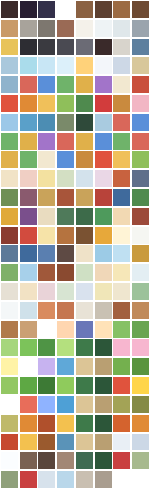

# Art style guide (locked)

The owner approved this style and palette on 28 October 2026 and asked for it to be locked. Everything drawn for
The Tiny Town, now and in later builds (residents, animation, effects, menus that show art), follows these rules
and uses only the colours below. Changing a rule or a colour needs the owner's approval first.

Approved changes: 28 October 2026, the back walls of rooms meet in a clean corner (the left wall no longer overlaps
the right one).

The lock is enforced by `Assets/Tests/EditMode/ArtStyleTests.cs`. It fingerprints the palette, the style rules and
the drawn ground, buildings, rooms, trees and furniture. Any change to them makes a test fail. Once the owner
approves a change, update this guide and the fingerprint in the same commit.

## Look and feel

- **Cosy storybook village.** Warm, soft colours; nothing harsh or neon. Greens and creams outdoors, wood and
  pastel wallpaper indoors. Each building is charming and a little different, never generic.
- **Pixel art, drawn by the game's code** (`Assets/Scripts/Art`). No smoothing: textures use point filtering, and
  every pixel is a solid colour except shadows and glass, which are see-through.
- **Hand-made, not perfect.** Edges between grass, paths and water wander slightly. Stones, planks, roof tiles and
  leaves vary a little in shade, chosen by `Noise` from their position, so the same town always looks the same.

## Projection and size

- **Isometric 2:1.** One tile is a 64 × 32 pixel diamond (`IsoPainter.HalfTileWidth` 32, `HalfTileHeight` 16),
  shown at 64 pixels per world unit. A map's x runs down to the right and its y runs down to the left.
- **Heights are in screen pixels.** Cottage walls are 42 pixels tall with a 42-pixel roof. Shop walls are 50 with a
  38-pixel roof. Room back walls are 64 pixels tall, front walls 12 and inner walls 40. Each map sits on a
  10-pixel block of earth (wooden boards for rooms), like a diorama.
- **Things stand on their tile.** A picture's anchor is the centre of the tile it stands on. Furniture and trees
  fit within a 72 × 104 canvas. Buildings fill their footprint, with eaves overhanging by about a quarter of a
  tile.

## Light and shade

- **Light comes from the upper left.** Box faces are lit at 1.0 for the top, 0.84 for the left face (facing +y) and
  0.68 for the right face (facing +x) (`IsoPainter.TopLight`, `LeftLight`, `RightLight`).
- **Shadows fall down and to the right.** They are soft and see-through: `Shadow` ellipses under trees and outdoor
  objects, and a `ShadowTint` wash on the ground beside buildings.
- **Outlines.** Trees, furniture and room walls have a one-pixel outline: the edge pixel is mixed 65% towards
  `Outline` (#3b2a2a), a warm dark brown, never black.
- **Day and night.** Sprites are multiplied by `Daylight` by day, `GoldenHour` at dawn and dusk (90-minute
  twilight) and `Moonlight` at night. Lit windows (`WindowGlow`) fade in after dusk and are not darkened. Rooms
  turn to `Lamplight` instead of going dark. Sunrise and sunset move with the season (`Lighting.SunTimes`).

## Seasons

A year is 28 days, with four 7-day seasons, spring first. Only the outdoors changes:

- **Spring:** fresh green grass, pale flowers, pink and white blossom on the trees, young shoots in the garden.
- **Summer:** deep green, bright flowers, fruit on the trees, ripe vegetables.
- **Autumn:** golden grass, orange and red trees with fallen leaves, pumpkins.
- **Winter:** snow on the ground, roofs, benches and pines; bare branches with snow on them; a frozen pond; paths
  cleared to grey stone.

## Places

- **Cottages:** plaster walls with a stone footing, sometimes timber-framed. Gable roofs of tile or thatch, a brick
  chimney, windows with white frames and flower boxes, and a coloured front door with a brass knob. Each cottage
  takes its wall, roof and door colour from the cottage lists, chosen by the cottage's id.
- **Shops:** taller walls, large display windows with goods in them, a striped awning with a scalloped edge and a
  sign over the door with a picture: an apple (store), a cup (café), a loaf (bakery) or a red cross (clinic, which
  has no awning).
- **Rooms:** doll's-house cutaways. The two back walls are tall and the same height, meeting in a clean inside corner, with wallpaper, a dado rail, a skirting board,
  windows and pictures. The front walls are low, and walls inside the room are half height. Floors are wooden
  boards in homes and the café, and tiles in the store, bakery and clinic.

## For the residents (build 2) and later work

- Use only colours from `Palette.cs`. A new colour must be approved and added there by name.
- Use the same light direction, outline colour, shadows and point-filtered pixels.
- Keep residents in proportion to the 64 × 32 tile and to doors, which are about 30 pixels tall.

## Palette

Every colour is named in `Assets/Scripts/Art/Palette.cs`, the only file where colours are written down. Shades of
these colours (for example a face lit at 0.84) are made by `Rgba.Shade` and `Rgba.Mix`. Seasonal colours are listed
once for each season. This table and `Images/palette.png` are made by `Tools/ArtPreview` (`dotnet run -- --palette
../../Documentation/Images/palette.png` in that folder).

| Name | Colour |
| --- | --- |
| Outline | `#3b2a2a` |
| Shadow | `#281e3246` |
| ShadowTint | `#33304a` |
| Highlight | `#ffffff` |
| Earth | `#8a6142` |
| EarthDark | `#5e4030` |
| Wood | `#9c6b43` |
| WoodDark | `#6e4a32` |
| WoodLight | `#c99a68` |
| Stone | `#a8a39b` |
| StoneDark | `#7d776f` |
| Brick | `#9a6a55` |
| White | `#f4f1ea` |
| Porcelain | `#eef3f5` |
| PorcelainShade | `#dfe7ea` |
| Metal | `#9aa4ad` |
| Brass | `#e8c35a` |
| Iron | `#2d2d33` |
| Charcoal | `#3a3a40` |
| Slate | `#4a4a52` |
| SlateLight | `#6b6b75` |
| Ebony | `#3a2a2a` |
| Ivory | `#d8d4cc` |
| Glass | `#5d7f9e` |
| GlassLight | `#a9c8dc` |
| ShowerGlass | `#aadceb` |
| DisplayGlass | `#c8e6f55a` |
| DisplayGlassTop | `#dcf0fa46` |
| WindowGlow | `#ffd27a` |
| Snow | `#f3f6fa` |
| SnowShade | `#cdd8e6` |
| Sand | `#d8c79a` |
| IceCrack | `#8fb3cc` |
| Red | `#d9675a` |
| Blue | `#5a8fd9` |
| Green | `#6fb36a` |
| Yellow | `#e0b04a` |
| Purple | `#a274c9` |
| Cream | `#f2e8d0` |
| Tomato | `#c94f3c` |
| Poppy | `#e0533d` |
| Pumpkin | `#e08a35` |
| Mustard | `#f0c05a` |
| Apple | `#8fbf5a` |
| LeafGreen | `#4f8a4e` |
| SignRed | `#d23c3c` |
| Bread | `#c98a3e` |
| Icing | `#f2b6c4` |
| Sky | `#9cc8e8` |
| Mat | `#5aa0c9` |
| MatDark | `#4c8db3` |
| Moss | `#7a8a6a` |
| Chalkboard | `#2f4a3a` |
| ClinicBlanket | `#a9cbe0` |
| Accents[0] | `#d9675a` |
| Accents[1] | `#5a8fd9` |
| Accents[2] | `#6fb36a` |
| Accents[3] | `#e0b04a` |
| Accents[4] | `#a274c9` |
| Bunting[0] | `#d9675a` |
| Bunting[1] | `#e0b04a` |
| Bunting[2] | `#5a8fd9` |
| Bunting[3] | `#6fb36a` |
| Goods[0] | `#d9675a` |
| Goods[1] | `#e0b04a` |
| Goods[2] | `#6fb36a` |
| Goods[3] | `#f2e8d0` |
| Goods[4] | `#5a8fd9` |
| Goods[5] | `#c98a3e` |
| WindowGoods[0] | `#e0533d` |
| WindowGoods[1] | `#f0c05a` |
| WindowGoods[2] | `#8fbf5a` |
| CottageWalls[0] | `#f1e3c6` |
| CottageWalls[1] | `#f0cfc4` |
| CottageWalls[2] | `#f3e1a0` |
| CottageWalls[3] | `#d3dfc3` |
| CottageWalls[4] | `#d3e2ec` |
| CottageWalls[5] | `#ead7e6` |
| CottageRoofs[0] | `#c8623f` |
| CottageRoofs[1] | `#5f6f8a` |
| CottageRoofs[2] | `#6f8f55` |
| CottageRoofs[3] | `#8a5a6e` |
| CottageRoofs[4] | `#c9a35a` |
| CottageRoofs[5] | `#a8553a` |
| Thatch | `#c9a35a` |
| CottageDoors[0] | `#b8433a` |
| CottageDoors[1] | `#3f6a9c` |
| CottageDoors[2] | `#4f8a4e` |
| CottageDoors[3] | `#e0a93a` |
| CottageDoors[4] | `#7a4f8c` |
| StoreWall | `#e9dcc0` |
| StoreRoof | `#4f7a5a` |
| StoreDoor | `#3d6b4a` |
| StoreAwning | `#4e9a5c` |
| CafeWall | `#f2d9b3` |
| CafeRoof | `#9c4a3a` |
| CafeDoor | `#8a3b30` |
| CafeAwning | `#d24b3e` |
| BakeryWall | `#f6e3a8` |
| BakeryRoof | `#b5733f` |
| BakeryDoor | `#7a5232` |
| BakeryAwning | `#e7a83a` |
| BakeryAwningStripe | `#fff4d6` |
| ClinicWall | `#f5f6f2` |
| ClinicRoof | `#5d7a99` |
| ClinicDoor | `#3f6a9c` |
| ShopAwning | `#5a7fb0` |
| WallCap | `#5e4a44` |
| FrontWallOutside | `#efe2c8` |
| RoomWindowSky | `#9ccbe6` |
| RoomWindowSkyHigh | `#bfe0f2` |
| PictureFrame | `#c99a3e` |
| PictureLand | `#7fb069` |
| PictureSky | `#a7d0ea` |
| Doormat | `#a0583a` |
| DoormatDark | `#8a4a30` |
| StoreWallpaper | `#cfe0c4` |
| CafeWallpaper | `#f0d7b8` |
| BakeryWallpaper | `#f6e7b8` |
| ClinicWallpaper | `#e3eef3` |
| ShopWallpaper | `#e6e0d4` |
| CottageWallpapers[0] | `#f2e2c4` |
| CottageWallpapers[1] | `#e9d3d8` |
| CottageWallpapers[2] | `#d7e4d2` |
| CottageWallpapers[3] | `#d9e2ee` |
| CottageWallpapers[4] | `#f0e6b8` |
| StoreFloor[0] | `#efe6cf` |
| StoreFloor[1] | `#9cc29a` |
| ClinicFloor[0] | `#f4f7f8` |
| ClinicFloor[1] | `#cfe1ea` |
| BakeryFloor[0] | `#d98b5f` |
| BakeryFloor[1] | `#c57650` |
| ShopFloor[0] | `#e8e2d6` |
| ShopFloor[1] | `#c9c1b3` |
| CafeFloor | `#a2603f` |
| CottageFloors[0] | `#c08a5a` |
| CottageFloors[1] | `#b07a4c` |
| CottageFloors[2] | `#caa074` |
| Daylight | `#ffffff` |
| GoldenHour | `#ffd6b0` |
| Moonlight | `#6a77b8` |
| Lamplight | `#ffe2b8` |
| Spring.Grass | `#86c165` |
| Spring.GrassDark | `#69a552` |
| Spring.GrassLight | `#a6d67c` |
| Spring.Leaves | `#7cc35a` |
| Spring.LeavesDark | `#4f9445` |
| Spring.LeavesLight | `#b4e07e` |
| Spring.PineLeaves | `#3e7a4a` |
| Spring.PineLeavesDark | `#2c5639` |
| Spring.Accent | `#f7b6cf` |
| Spring.Flowers[0] | `#f7b6cf` |
| Spring.Flowers[1] | `#fff3a6` |
| Spring.Flowers[2] | `#ffffff` |
| Spring.Flowers[3] | `#c7b3f0` |
| Spring.Water | `#5fa8d8` |
| Spring.Path | `#dcc596` |
| Spring.PathDark | `#b99f72` |
| Summer.Grass | `#74b04e` |
| Summer.GrassDark | `#5a943e` |
| Summer.GrassLight | `#93c763` |
| Summer.Leaves | `#5ea844` |
| Summer.LeavesDark | `#3d7a35` |
| Summer.LeavesLight | `#8fcb5c` |
| Summer.PineLeaves | `#3e7a4a` |
| Summer.PineLeavesDark | `#2c5639` |
| Summer.Accent | `#e0533d` |
| Summer.Flowers[0] | `#ffd54a` |
| Summer.Flowers[1] | `#ffffff` |
| Summer.Flowers[2] | `#e86d5a` |
| Summer.Flowers[3] | `#8fb3ff` |
| Summer.Water | `#4ea0d6` |
| Summer.Path | `#dcc596` |
| Summer.PathDark | `#b99f72` |
| Autumn.Grass | `#a3a356` |
| Autumn.GrassDark | `#858a45` |
| Autumn.GrassLight | `#bfb96a` |
| Autumn.Leaves | `#e08a35` |
| Autumn.LeavesDark | `#b0502c` |
| Autumn.LeavesLight | `#f3c14f` |
| Autumn.PineLeaves | `#3e7a4a` |
| Autumn.PineLeavesDark | `#2c5639` |
| Autumn.Accent | `#d4632e` |
| Autumn.Flowers[0] | `#e08a35` |
| Autumn.Flowers[1] | `#c6482f` |
| Autumn.Flowers[2] | `#f3c14f` |
| Autumn.Flowers[3] | `#9a5a2e` |
| Autumn.Water | `#5a93b8` |
| Autumn.Path | `#dcc596` |
| Autumn.PathDark | `#b99f72` |
| Winter.Grass | `#e9eff5` |
| Winter.GrassDark | `#ccd8e6` |
| Winter.GrassLight | `#fbfdff` |
| Winter.Leaves | `#7a6152` |
| Winter.LeavesDark | `#5a463c` |
| Winter.LeavesLight | `#a28775` |
| Winter.PineLeaves | `#3f6b52` |
| Winter.PineLeavesDark | `#2c5639` |
| Winter.Accent | `#c94040` |
| Winter.Flowers[0] | `#a7b98e` |
| Winter.Flowers[1] | `#8fa07a` |
| Winter.Flowers[2] | `#c94040` |
| Winter.Flowers[3] | `#d7e2ec` |
| Winter.Water | `#b9d7ea` |
| Winter.Path | `#c9bfb1` |
| Winter.PathDark | `#a99d8f` |
