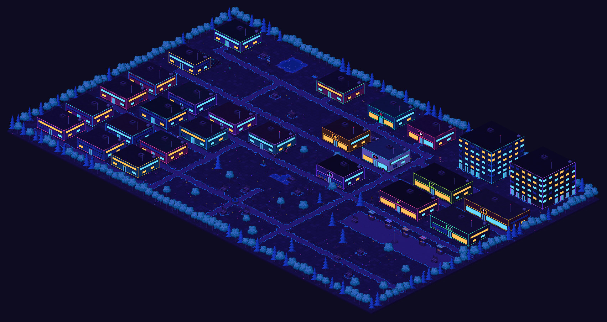
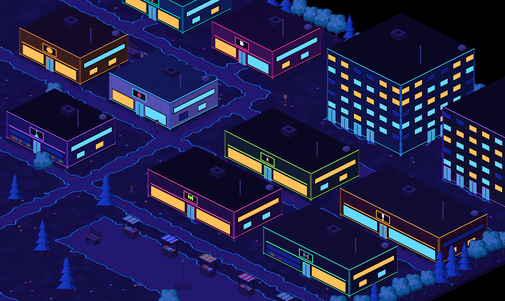
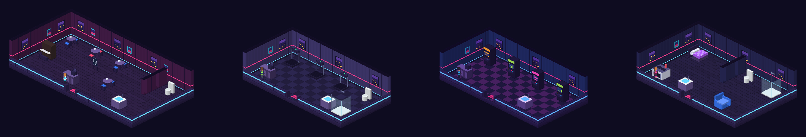
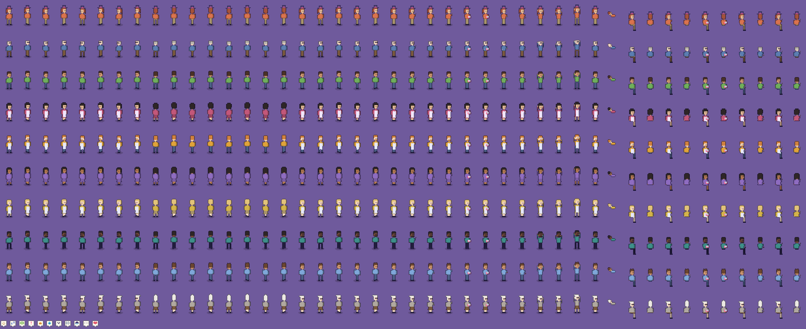

<div align="center">



# Tiny City

**A cosy little neon city that lives its own life. Fifteen residents work, shop, make friends, fall in love, fall ill, grow old and remember it all, while you watch through as many camera panels as you like. A local AI on your own PC can choose what they do and write what they say.**


[](LICENSE)

[What it is](#what-it-is) · [Hobby project](#a-hobby-project) · [Screenshots](#screenshots) · [Features](#features) · [Play it](#play-it) · [Local AI](#the-local-ai) · [Controls](#controls) · [Build from source](#building-from-source) · [Licence](#licence) · [Credits](#credits)

</div>

---

## What it is

**Tiny City** is an isometric pixel-art life simulation that you watch rather than play. You don't control anyone. The residents get up, go to work, cook, pay the rent, meet in the park, go dancing at the bar on a Friday night, and go home to bed, each by their own rules and their own personality.

- **A small neon city.** Sixteen cottages, two apartment towers, a café, a bakery, a store, a clinic, a bar, a gym, bowling lanes, an arcade, a cue club, a park and a market square, drawn in a neon cyberpunk style that changes with the seasons and glows at night.
- **People with lives.** Fifteen residents with needs, jobs, money, hobbies, friendships, memories and life stories. They age a year every 28 game days, and new people move to town over time.
- **A local AI, if you want one.** With [Ollama](https://ollama.com) running on your PC, the AI chooses residents' free time, writes their conversations and their end-of-day thoughts. The game checks every answer against its own rules. Without it, everyone follows a built-in routine and simple small talk, and the game plays just the same.
- **Nothing online.** The AI runs on your own computer. Nothing is uploaded, and there are no accounts.
- **Made by code.** Every building, resident, tune and sound effect is generated by the game's own code. There are no bought or borrowed assets.

## A hobby project

> [!NOTE]
> Tiny City is a **hobby project**, made in spare time by one person with the help of an AI coding assistant. It's shared for free in the hope that someone enjoys it, but please go in with your eyes open:
>
> - **It's still being made.** Things change between builds, and there will be bugs. Some may never be fixed.
> - **Back up anything you care about**, such as your towns in `%USERPROFILE%\AppData\LocalLow\Tiny City\Tiny City\Towns\` and your settings in `player-settings.json` beside that folder.
> - **The AI is optional and local.** How well it does depends on your PC and the model you choose.
>
> **It's offered as it is**, with no warranty, no support and no promised updates. Issues are turned off and I'm not able to answer questions, take requests or fix problems. You're welcome to play it, learn from it and change it for your own use under the [MIT licence](LICENSE).

## Screenshots

These are drawn by the game's own art code (`Tools/ArtPreview`), the same code the game uses on screen.

| Shops and towers after dark | Inside: the café, the gym, the arcade at night and a flat |
| --- | --- |
|  |  |

<details>
<summary><b>Every resident's look and pose</b></summary>



</details>

## Features

### The city
- A 64 × 40 tile isometric city with sixteen cottages, two six-floor apartment towers with eight flats each, shops, venues, a park with a fountain and a market square
- Every building has its own room inside, seen like a doll's house, and residents walk in and out through the doors
- Four seasons of seven days each, with day and night light, lit windows and glowing neon signs after dark
- Synth music for day and night, city and indoor ambience, and sounds for footsteps, doors, cooking, typing, the till and more

### The people
- **Needs and routines:** hunger, energy, hygiene, fun, social life and more, with bedtimes and get-up times of their own
- **Jobs and money:** wages paid to the penny when a shift ends, rent every Monday, groceries, café meals and bar drinks. Empty jobs are filled by jobseekers
- **Friends and romance:** chats over several turns, friendships, trust and grudges, and (if you leave it on) dating, commitment, quarrels, break-ups and making up
- **Hobbies:** painting, piano, chess, fishing, gardening, baking and knitting, with invitations for a neighbour to join in
- **Health and age:** colds, flu and pneumonia, visits to the clinic, birthdays, life stages, old age and death. The dead stay in the town's records and their neighbours remember them
- **Newcomers and families:** people move to town (always with a surname nobody has had before), couples can have babies, and children grow up and move out
- **Memories:** each resident remembers what happened to them and who they met, and the AI uses those memories when it writes

### Watching
- **Camera panels:** up to sixteen at once, each following a resident or looking around any place. **Watch Everyone** gives each resident their own panel, and **Town View** shows the whole city in one
- **Hover cards:** point at a building to see its name, whether it's open and who is inside, and double-click to look inside
- **Auto cycle:** the **Cameras** button sets the panels to take turns by themselves every 30 minutes to 12 game hours, showing residents, buildings, half of each or everything, shared out across however many panels are open
- **Labels on demand:** furniture names show while someone is using it or when you point at it, so the view stays clear
- **The inspector:** a side panel with the chosen resident's needs, plans, people, memories, work, money and life story, and a searchable list of everyone in town
- **The town journal:** every birthday, friendship, romance, illness, move and death, searchable and exportable as text, with pop-up notifications for the big moments
- **Saved towns:** several towns side by side, with autosave, copying, renaming and exporting
- **Settings:** the local AI and its model, volumes, window and frame rate, and a dark or light theme. There's also a camera panel test that measures how many panels your PC can show smoothly

## Play it

Tiny City isn't on a store or on this page's Releases yet. Builds are made automatically by GitHub Actions:

1. Open the [Actions](../../actions) tab and pick the latest green run on `main` (you need to be signed in to GitHub to download).
2. Download the **`TinyCity-Windows-…`** artifact at the bottom of the run page. It's a zip.
3. Extract the whole zip (keep `TinyCity_Data` next to the exe) and run **`TinyCity.exe`**.

Windows may show **"Windows protected your PC"** because the game isn't code-signed. Click **More info**, then **Run anyway**.

A new game starts on day 1 at 07:00 with fifteen residents waking up.

## The local AI

The AI is optional. To use it:

1. Install **[Ollama](https://ollama.com/download)** and start it.
2. Download the default model in a command prompt:
   ```
   ollama pull qwen2.5:7b
   ```
3. Start Tiny City. It finds Ollama on `http://localhost:11434` by itself. In **Settings** you can turn the AI on or off and pick any model you have installed.

The full guide, with every setting and fixes for common problems, is in [Documentation/OllamaSetup.md](Documentation/OllamaSetup.md).

## Controls

| Key | What it does |
|---|---|
| Space | Pause and carry on |
| 1 – 4 | Game speed |
| F5 / F9 | Save / load the town you're playing |
| + / − | Add or remove a camera panel |
| N / B | Next / previous resident in the active panel |
| Tab | Turn the active panel into a free camera and move it to the next place |
| F | Follow the chosen resident |
| Drag, mouse wheel | Pan and zoom a free camera |
| J | Town journal |
| S | Saved towns |
| H | Hide or show the side panel |
| Esc | Close the open window |

## Building from source

Tiny City is a Unity **6000.3.27f1** (6.3 LTS) project written in C#. Open the folder in Unity Hub with that version and press Play, or build Windows from the command line:

```
Unity.exe -batchmode -quit -projectPath . -executeMethod TinyCity.Editor.BuildScript.BuildWindows -customBuildPath Builds/Windows/TinyCity.exe
```

All the game's rules, art and sound live in assemblies that don't use Unity, so they can be tested with plain .NET 8:

```
dotnet test DotNetTests
```

The full instructions, including the Unity licence secrets the GitHub Actions build needs, are in [Documentation/BuildAndTest.md](Documentation/BuildAndTest.md).

### Where things are

| Path | What's in it |
|---|---|
| `Assets/Scripts/Simulation` | Every game rule: needs, routines, jobs, money, health, friendships, romance, families, memories, the AI queue and saving |
| `Assets/Scripts/Art` | The pixel art, drawn in code from a locked palette |
| `Assets/Scripts/Sound` | The music, ambience and sound effects, made in code |
| `Assets/Scripts/Runtime` | The Unity side: drawing, cameras, the inspector, windows and sound playback |
| `Assets/Tests` | Edit Mode and Play Mode tests |
| `Tools/ArtPreview`, `Tools/StressTest` | Drawing the art and measuring performance without Unity |
| `Documentation/` | Design notes, art style, overrides, Ollama setup, test checklists and stress test results |
| `GameDesignDocument.md` | The design of the whole game |

### Make it your own

- Swap any picture for your own PNG: [Documentation/ArtOverrides.md](Documentation/ArtOverrides.md)
- Swap any sound or tune for your own WAV: [Documentation/SoundOverrides.md](Documentation/SoundOverrides.md)
- The locked art style and colours: [Documentation/ArtStyle.md](Documentation/ArtStyle.md)

## Made with AI

Tiny City was written with **[Anthropic's Claude](https://claude.ai/code)** as the coding assistant, working from the design, requests and playtesting of the project's owner. No code, pictures or sounds were copied from any other project:

- Every picture is drawn by code from a palette of named colours.
- Every tune and sound is synthesised by code.
- The randomness uses two published, public-domain hash methods (FNV-1a and MurmurHash3's finaliser), so a town always plays out the same way from the same save.

## Licence

Copyright © 2026 BigDaddy284.

Tiny City is released under the **[MIT licence](LICENSE)**. In plain words: you can use, copy, change, share and even sell it, as long as you keep the copyright and licence notice. It comes **without any warranty**.

The Unity engine inside a Windows build stays under Unity's own terms, and Ollama and the AI models are installed separately under their own licences.

## Credits

Everything the game uses that belongs to someone else (Unity, Ollama, the Qwen2.5 model, GameCI, GitHub Actions, .NET and NUnit, and the two hash methods) is listed with its licence in **[CREDITS.md](CREDITS.md)**.

---

<div align="center">

Tiny City is provided "as is", without warranty of any kind. This summary isn't legal advice: the licence texts linked above are what apply.

</div>
